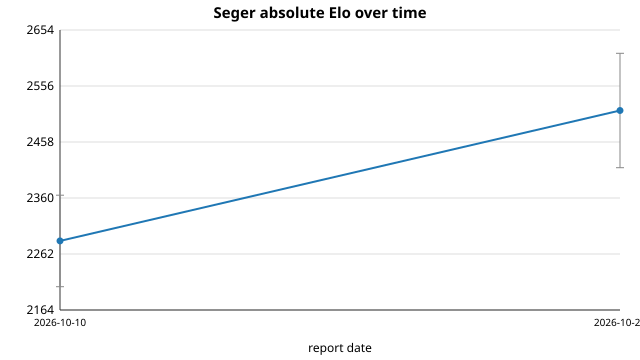

# Seger Elo report — 2026-10 (rerun, 2026-10-28)

**Verdict: within noise (flat).** The engine source is **unchanged** since the
previous report (`8fa6506` is both `HEAD` and the previous report's commit, zero
commits in between), so no strength change is possible or claimed. Both
measurements land where the previous report put them: fixed-depth self-play
reproduces to the game (0.350, -107.5 Elo) and the Stockfish anchors read
~2569 Elo against the previous ~2513 — a ~56 Elo difference that is well inside
the anchors' own confidence intervals.

## Self-play vs the pinned reference

- Command: `python3 tools/selfplay.py --a build/seger --b /tmp/seger_ref_bin --games 60 --depth 5 --parallel 4 --max-seconds 300`
- Reference sha (`reports/elo/baseline.sha`): `e58ee82621563a26ad2edd7138d91d6fc03e71f1`
- Current `HEAD`: `8fa6506` (0 commits since the previous report, 31 since the reference).
- Result: A (HEAD) 8 W, 26 D, 26 L — **A score 21.0/60 = 0.350**, Elo delta
  **-107.5** (+/- 92 at 95%).

This is a byte-for-byte reproduction of the previous report's self-play line
(same score, same W/D/L split), the expected outcome for an unchanged binary. As
before, the negative reading is a *fixed-depth* artifact: the reference predates
the move-ordering fix, so at fixed depth 5 the current build searches a much
smaller tree (849K vs 140.5M nodes at depth 9) and loses thoroughness, while
under a time control the same speed converts to extra depth and wins. The
absolute anchor below is the number that reflects playing strength.

## Absolute strength vs Stockfish

Stockfish 17 (`/usr/games/stockfish`), limited with `UCI_LimitStrength`/`UCI_Elo`,
one thread, 100 ms/move, colours alternated over the standard opening set. The
second anchor is decorrelated by `--opening-offset 40`. Command:
`python3 tools/vs_stockfish.py --seger build/seger --stockfish /usr/games/stockfish --elo 2400 --elo 2500 --games 40 --movetime 0.1`.

| SF anchor | Seger score | W/D/L   | Seger estimate | 95% interval |
|-----------|-------------|---------|----------------|--------------|
| 2400      | 0.725       | 24/10/6 | 2568           | +/- 121      |
| 2500      | 0.600       | 19/10/11| 2570           | +/- 110      |

Combined point estimate: **~2569 Elo** (ballpark, +/- ~85). The two anchors agree
with each other to 2 Elo, which is reassuring, but each interval is over 100 Elo
wide at 40 games, so treat the number as a ballpark. This is Seger against
Stockfish's own `UCI_Elo` calibration at a short time control, not an official
rating-list number.

## Commits on main since the previous report

**None.** The previous report's commit `8fa6506` is the current `HEAD`; the only
diff between the previous report's tree and this one is the report / history /
trend bookkeeping itself. There is therefore no code change to attribute strength
to this month — any apparent movement is measurement noise. (31 commits separate
`HEAD` from the pinned reference `e58ee82`, all already accounted for in the
previous report.)

## Honest note

The engine is identical to the previous report, so the ~56 Elo difference between
this run's ~2569 and the previous ~2513 is **smaller than the confidence interval**
of either measurement (each over 100 Elo) and must be read as run-to-run variance,
not improvement. The fixed-depth self-play number (-107.5) is likewise unchanged
and remains the expected fixed-depth cost of the pruning that buys depth under a
time control. This report is a re-measurement confirming the previous result, not
a new strength claim.
