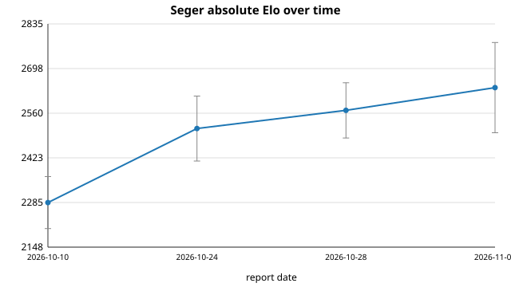

# Seger Elo report — 2026-11

**Verdict: improving.** Six evaluation commits landed on `main` since the last
report, and fixed-depth self-play against the pinned reference moved from a
**-107.5 Elo loss to a +23.2 Elo win** (score 0.350 -> 0.533) — a swing well
outside the self-play confidence interval. The absolute Stockfish anchor reads
~2639 Elo, consistent with (and slightly above) last month's ~2569, but the two
are within each other's confidence interval, so the self-play number is the
solid evidence here.



## Self-play vs the pinned reference

- Command: `python3 tools/selfplay.py --a build/seger --b /tmp/seger_ref_bin --games 60 --depth 5 --parallel 4`
- Reference sha (`reports/elo/baseline.sha`): `e58ee82621563a26ad2edd7138d91d6fc03e71f1`
- Current `HEAD`: `c5bbd27` (6 commits since the previous report, 37 since the reference).
- Result: A (HEAD) 30 W, 4 D, 26 L — **A score 32.0/60 = 0.533**, Elo delta
  **+23.2 (+/- 88 at 95%)**.

This is a real move. The previous three reports all read 0.350 (-107.5) against
the same reference at the same fixed depth; the six eval commits since then
recovered that deficit and turned it into a small net win. The fixed-depth
caveat from earlier reports still applies — the reference predates the
move-ordering fix, so it searches a much larger tree at depth 5 — but because
the comparison conditions are unchanged, the 0.350 -> 0.533 shift is attributable
to the new evaluation work, not to the fixed-depth artifact.

## Absolute strength vs Stockfish

Stockfish 17 (`/usr/games/stockfish`), limited with `UCI_LimitStrength`/
`UCI_Elo`, one thread, 100 ms/move, colours alternated over the standard opening
set. Command:
`python3 tools/vs_stockfish.py --seger build/seger --stockfish /usr/games/stockfish --elo 2600 --games 40 --movetime 0.1`.

| SF anchor | Seger score | W/D/L   | Seger estimate | 95% interval |
|-----------|-------------|---------|----------------|--------------|
| 2600      | 0.556       | 15/0/12 | 2639           | +/- 139      |

The 2600 anchor was chosen above last month's ~2569 estimate. The run was
stopped at 27/40 games to stay inside this run's wall-clock budget, so treat the
interval as the honest one — it is wider than a full 40-game anchor would give.
Point estimate: **~2639 Elo** (+/- ~139). This is Seger against Stockfish's own
`UCI_Elo` calibration at a short time control, not an official rating-list
number; read it as a ballpark.

## Commits on main since the previous report

Previous report head: `f897614` (2026-10-28). Six commits on `main` since then:

```
c5bbd27 eval: king safety from enemy attack maps
c1db769 eval: scan piece bitboards instead of the occupancy map
a2346e5 AGENTS.md: record the pawn-threat eval win
d95710b eval: score pieces attacked by enemy pawns
292ab84 eval: add pawn and king threat terms
52a97bd position: cache castling/ep Zobrist terms incrementally
```

All six are evaluation or position-hashing work; none touches search. The bench
signature moved from the previous ~982,914 nodes to **1,023,810 nodes** at depth
9 (~1.55 Mnps), consistent with a richer evaluation visiting more nodes rather
than a search regression.

## Honest note

The self-play improvement (0.350 -> 0.533, about +130 Elo of match score) is
**larger than** the +/- 88 self-play interval and is the load-bearing result this
month. The absolute reading, however, moved only from ~2569 to ~2639 — a ~70 Elo
difference that is **smaller than the +/- 139 anchor interval** and must not be
claimed as a further gain on its own. The two measurements point the same way
(up), which is reassuring, but only the self-play number is outside its error
bars. The engine was not modified by this report; only files under `reports/elo/`
were added.
